<div align="center">

# procedural-art

**Real mountains, glass and paintings made with code and real elevation data. No image model.**

Three Claude skills. Name any mountain on Earth and get an engraving, a woodcut, a photograph, or a painting of it. Or name any subject and watch it painted in oils, stroke by stroke.

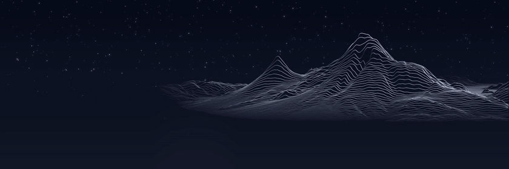

[](https://github.com/dogum/procedural-art/actions/workflows/ci.yml)
[](https://github.com/dogum/procedural-art/releases/latest)
[](LICENSE)
[](#install)

**[Try any mountain in your browser](https://dogum.github.io/procedural-art/app/)** · **[Watch a painting paint itself](https://dogum.github.io/procedural-art/paint/)** · **[Showcase](https://dogum.github.io/procedural-art/)** · **[Studios](https://dogum.github.io/procedural-art/#studios)** · **[Latest release](https://github.com/dogum/procedural-art/releases/latest)** · **[Changelog](CHANGELOG.md)**

</div>

---

It started as an attempt to recreate an AI-generated header of Mount Ararat with math instead of a model, drawn from the real mountain's elevation. From there it grew into three skills:

| Skill | What it makes |
|---|---|
| **[procedural-terrain-art](skills/procedural-terrain-art)** | Any real mountain, range, canyon or island in six print styles, looping orbit videos, and a self-contained interactive studio page. |
| **[procedural-realism](skills/procedural-realism)** | Photographic terrain (sky, haze, snow, lakes, forests, city lights, sun timelapses), a path tracer for glass and metal still lifes, and a painterly finisher for any image. |
| **[procedural-painting](skills/procedural-painting)** | An original oil painting of any subject, composed in code and laid as simulated brush strokes with real pigment mixing and impasto, plus a film of the canvas being painted. |

Every terrain pixel comes from SRTM-derived elevation, numpy and physics. Nothing is downloaded except elevation tiles, and no generative model is involved at any step.

## Paintings from nothing

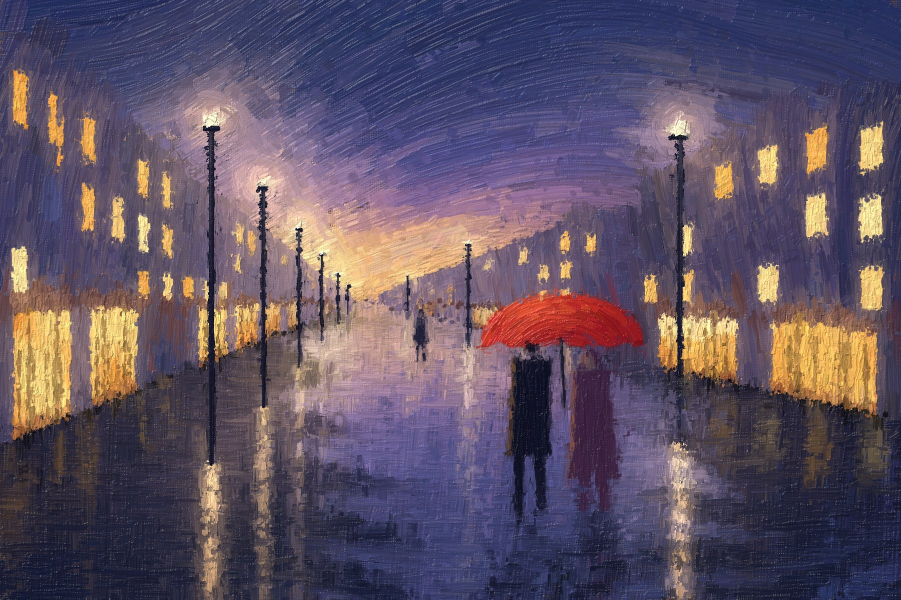

No photo, no render and no model is behind this picture. Claude wrote [under 300 lines of Python](skills/procedural-painting/studies/rain_at_blue_hour.py) that say what is in it (two rows of houses running to a vanishing point, nine lamps, a mirror of all of it in the wet road, two figures and an umbrella) and which way the brush moves over each part. A paint simulator did the rest in 32,000 strokes and 70 seconds on one CPU core.

<table>
<tr>
<td width="50%">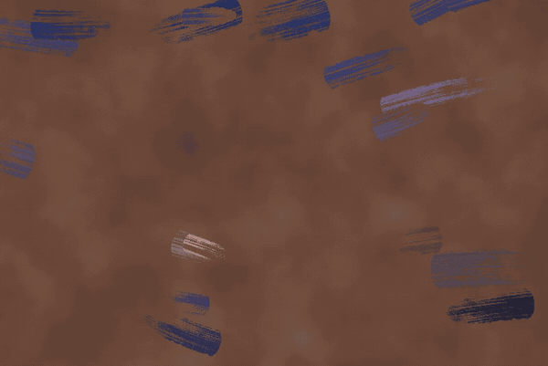<br>The same canvas painting itself (<a href="https://dogum.github.io/procedural-art/media/pt_rain.mp4">mp4</a>)</td>
<td width="50%">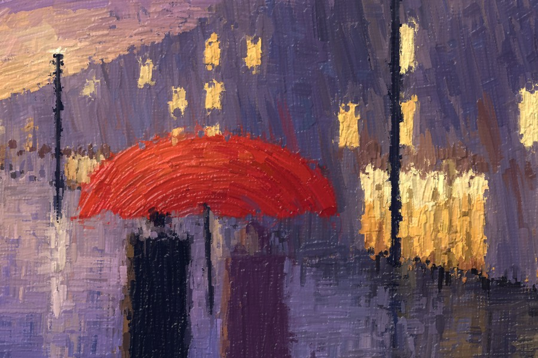<br>Detail at 1:1: bristle tracks, canvas weave, thick lights</td>
</tr>
<tr>
<td width="50%">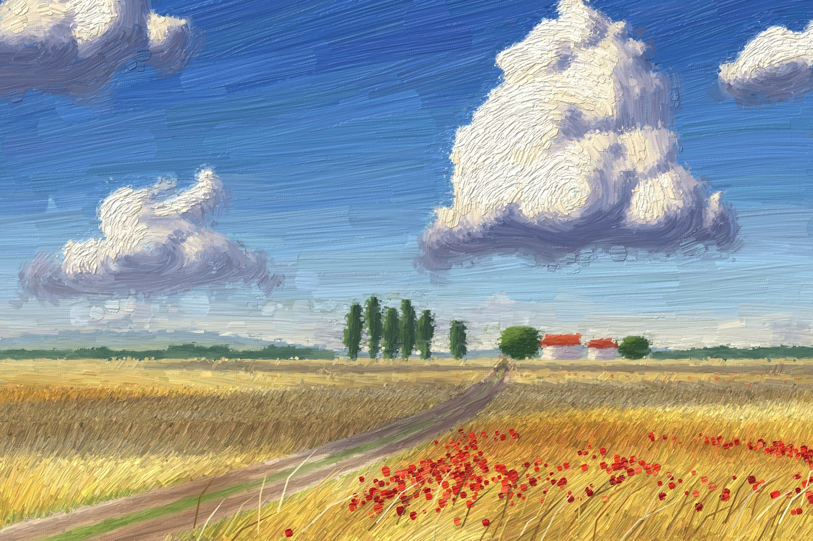<br><a href="skills/procedural-painting/studies/wind_over_the_barley.py">Wind over the barley</a></td>
<td width="50%">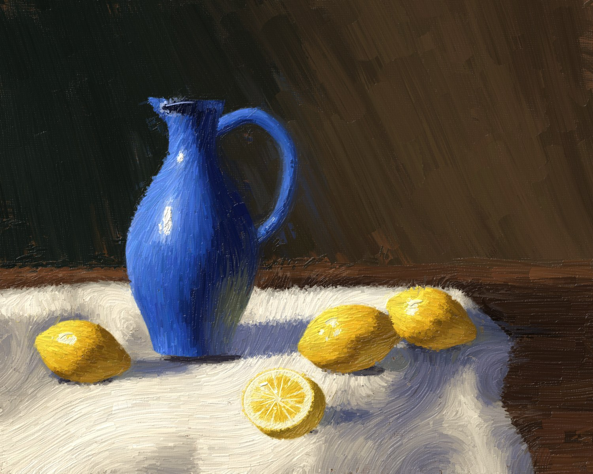<br><a href="skills/procedural-painting/studies/lemons_and_blue_jug.py">Lemons and a blue jug</a></td>
</tr>
</table>

What the paint does:

- **Colour mixes like pigment.** Every colour is a 12-band reflectance spectrum and mixing happens on Kubelka-Munk absorption and scattering. Blue dragged into wet yellow goes green; in RGB it goes grey.
- **Strokes are bristles.** Each bristle track carries its own paint, runs dry toward the end of the stroke, skips the valleys of the canvas weave, and drags the wet paint it crosses.
- **Paint has thickness.** Stroke bodies, ridges and bristle grooves build a relief that is lit from the side, with thick paint only in the lights.
- **The brush knows what it is painting.** Direction, size and edge are chosen per mass: sweeps across a sky, upright pulls down a wall, reflections dragged straight down and then cut across.

### Painted in sittings, with a look between each

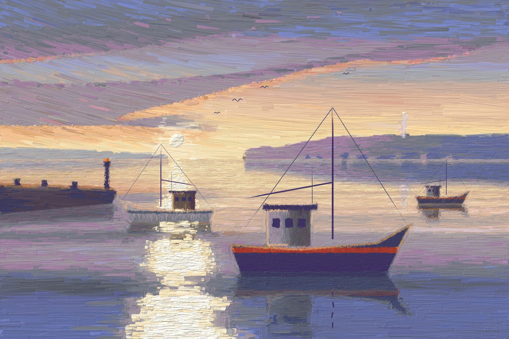

A painter does not plan every stroke and then close their eyes. `sitting.py` keeps a painting as a folder of small files, one per sitting; after each one Claude looks at the canvas beside the study (and at both in grey, and at a map of where they differ) and decides what the next sitting is, or repaints the last. The harbour took five sittings and three corrections: a first sky that went muddy, glitter that looked like confetti, strokes poking over the horizon. It uses six tubes of paint and nothing else.

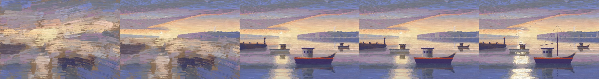

<table>
<tr>
<td>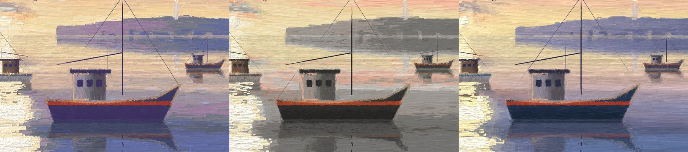<br>The same script three ways: <code>--knife</code> · <code>--palette "yellow ochre, vermilion, ivory black, titanium white"</code> · <code>--palette full</code></td>
</tr>
</table>

### A painting that moves

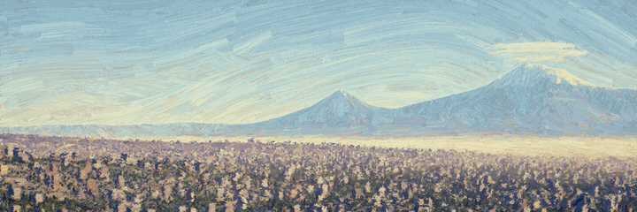

Ararat from golden hour into night, along the real sun path for the date: 241 frames, and every one is the same canvas ([mp4](https://dogum.github.io/procedural-art/media/pt_ararat_film.mp4)). Painting each frame separately makes the brushwork boil. Here the first frame is painted once and every stroke is remembered; for each later frame the same strokes are laid again, in the same order on the same weave, in that frame's colours. At a few key frames the painter adds only what the fixed strokes cannot show: a shadow edge that moved, and the city's lamps, which are laid only while they are lit. Frame to frame, the painted film changes exactly as much as the footage it was painted from (1.9 levels out of 255 on average).

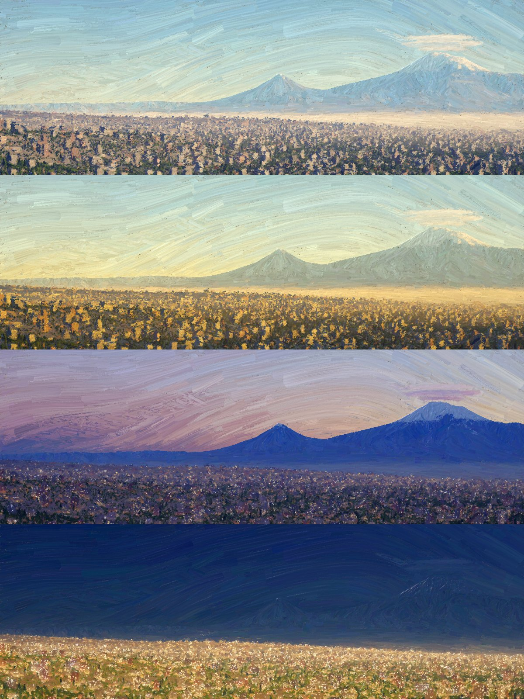

### A second medium: watercolour

<table>
<tr>
<td width="62%">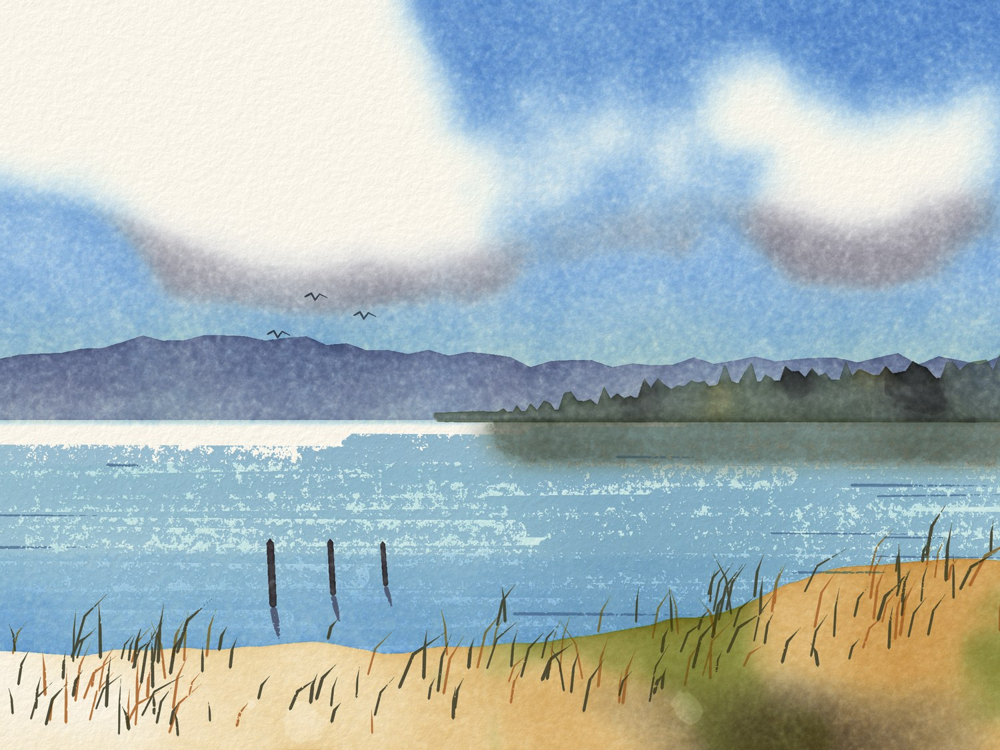<br><a href="skills/procedural-painting/studies/estuary_in_watercolour.py">Estuary</a></td>
<td width="38%">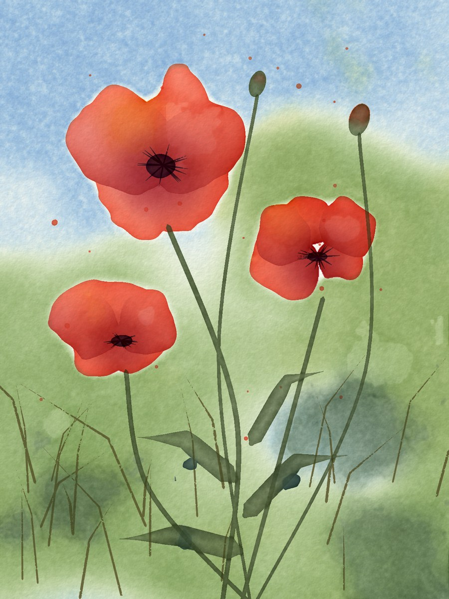<br><a href="skills/procedural-painting/studies/poppies_in_watercolour.py">Poppies</a></td>
</tr>
</table>

Watercolour is not oil paint made thin, so it has its own simulator (`aquarelle.py`). The white of the paper is the light and nothing covers it: the clouds and the sparkle on the water are sheet left bare. Layers are transparent, a wash on wet paper has no edge while the same wash on dry paper keeps one and dries darker at its rim, heavy pigments settle into the valleys of the paper, and a dry brush skips them. About a minute at 2133 × 1600.

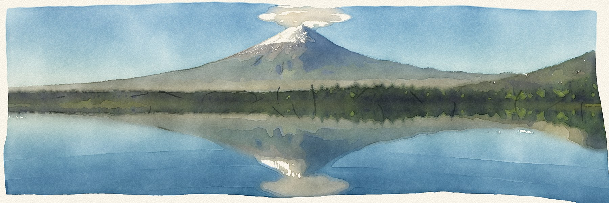

`aquarelle_repaint.py` paints any picture as a watercolour, in a watercolourist's order: the lights are reserved as bare paper, the sky is dropped into wet paper, far planes are pale washes and each nearer one is darker with a hard top edge. With the terrain renderer's painter buffers (`--aov`) it knows snow from cloud and near from far. This is the Fuji render from the top of this page; about 45 seconds. Below, Ararat painted with the buffers.

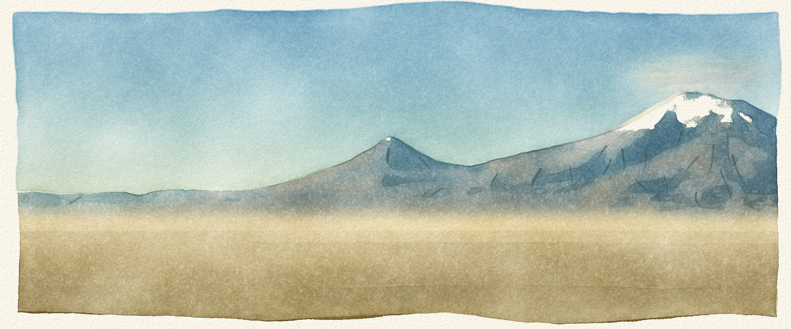

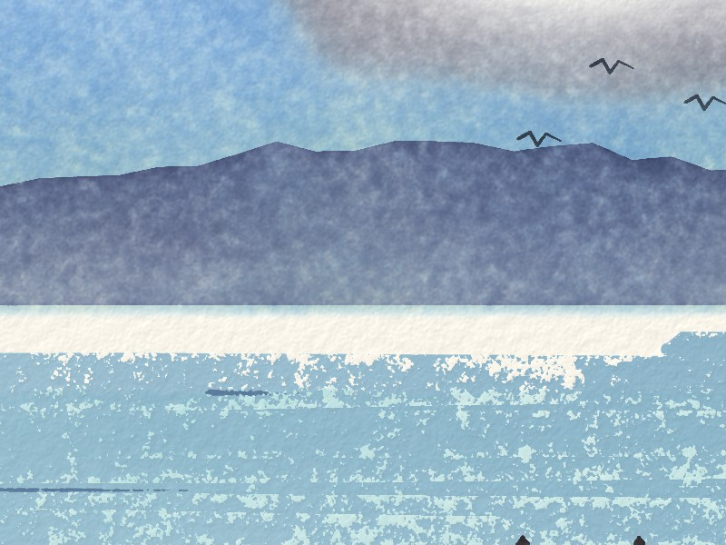

### Set the subject up in 3D, then paint it

<table>
<tr>
<td width="50%">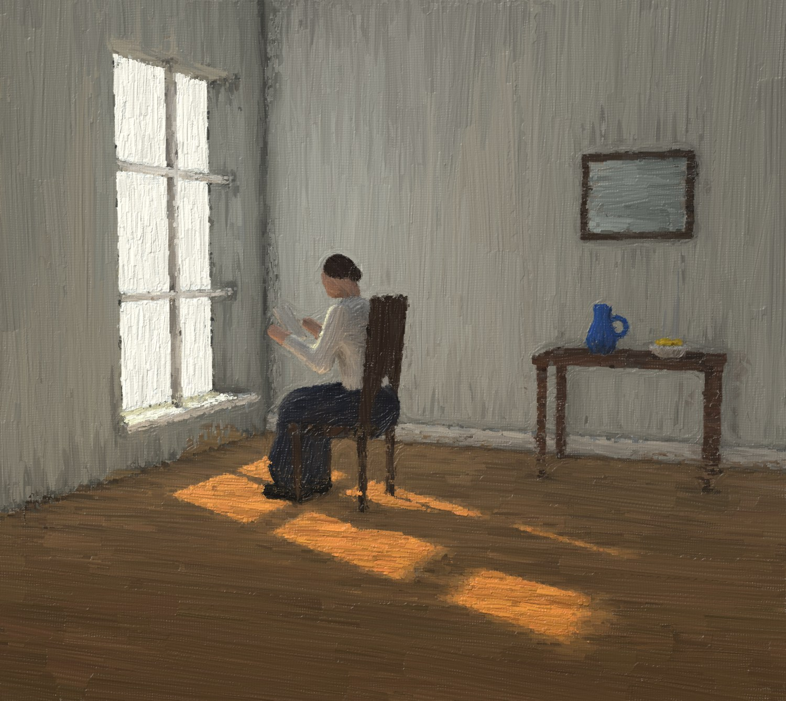<br><a href="skills/procedural-painting/studies/the_letter.py">The letter</a></td>
<td width="50%">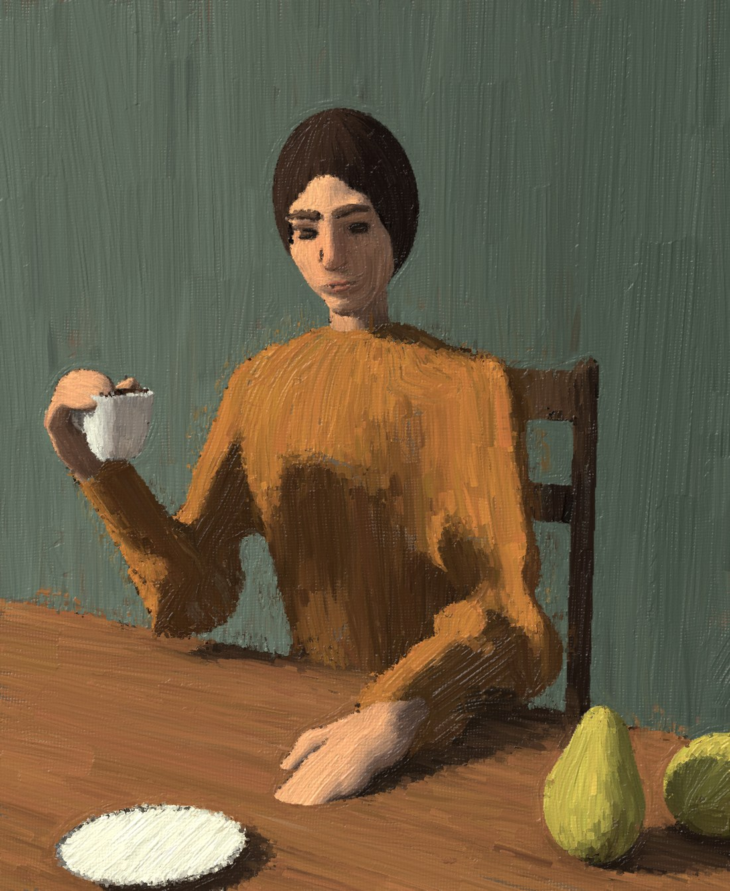<br><a href="skills/procedural-painting/studies/the_white_cup.py">The white cup</a>: the figure at half length, with a face, hands and folded cloth</td>
</tr>
</table>

A flat study has to be drawn by hand, which is why figures and interiors were out of reach. `stage.py` lets the painter set the subject up instead: solids, posable figures, a camera and a light. The room's perspective, the patch of sun broken by the glazing bars, and the shadows of the figure and the chair all come from the geometry, and the brush follows each form without being told (down limbs, along floorboards, upright on walls). The same stage reads the path tracer's scene files, so one file gives a photograph and a painting:

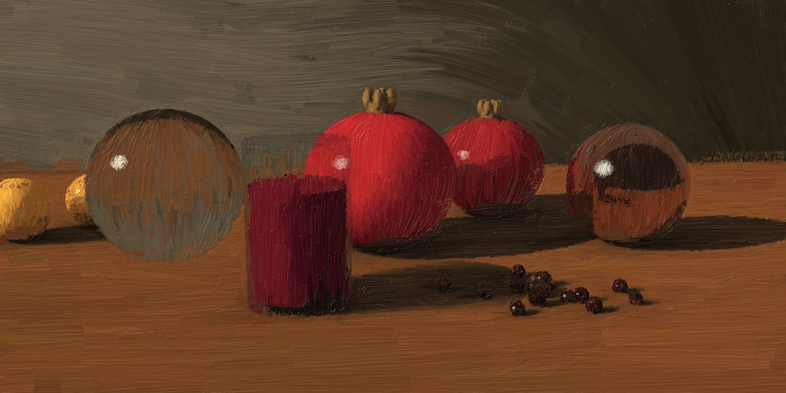

### Watch one paint itself

**[The easel](https://dogum.github.io/procedural-art/paint/)** is not a video. The page holds the list of strokes and a JavaScript port of the paint simulator, and your browser lays every stroke again, wet into wet, in 10 to 25 seconds. Drag the light to see that the paint has thickness. The fifth canvas, *Ararat, dusk into night*, is a moving painting: pick an hour and the same 42,000 strokes are laid again in that hour's light, or let the whole evening pass. And the brush is yours too: pick a tube colour and drag on any canvas, or start from a blank one. It is the same paint, so your stroke mixes as pigment with the wet paint it crosses and runs dry on a long pull.

### Real mountains, painted by their ground

The terrain renderer can hand the painter what it knows about every pixel: depth, the downhill direction, slope, snow, water. Slopes are then painted with strokes running down the fall lines, snow goes on late and thick, and a lake is dragged straight down and cut across.

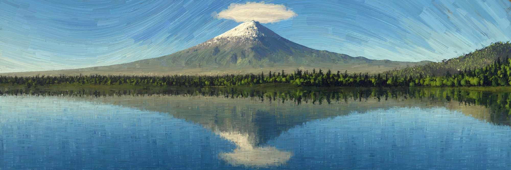
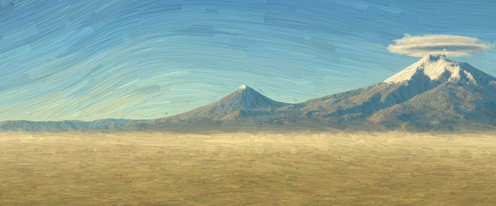

## Any mountain, in your browser

<a href="https://dogum.github.io/procedural-art/app/">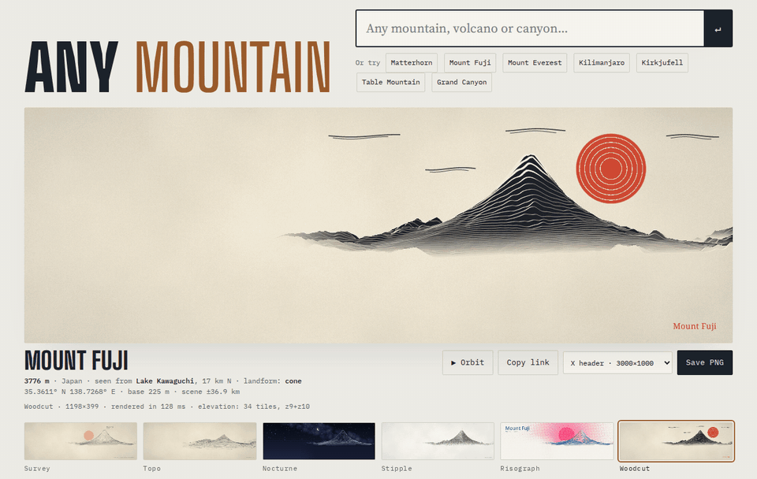</a>

**[Any mountain](https://dogum.github.io/procedural-art/app/)** is the terrain engine as a web page. Type a peak, volcano or canyon, drag the viewpoint on the map, pick a style, and save a 3000 × 1000 header (or a LinkedIn, YouTube or wallpaper size). The page downloads 20 to 40 elevation tiles and measures the landform itself, so there is no server; a copied link reopens the same mountain, view and style. It draws with the same code as the studios below. 94 well-known peaks come with their classic viewpoint; anything else found on OpenStreetMap gets an automatic one.

## One mountain, six prints

Masis and Sis (Ararat) seen from Yerevan. Same elevation grid, same hidden-line buffer, six ways of drawing it.

<table>
<tr>
<td width="33%">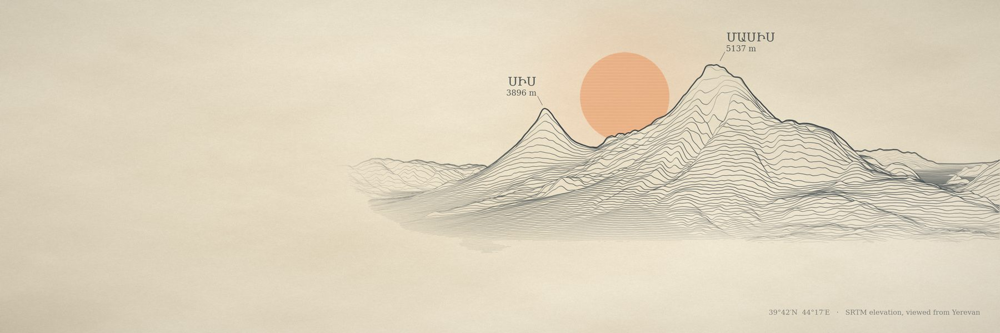<br><code>survey</code></td>
<td width="33%">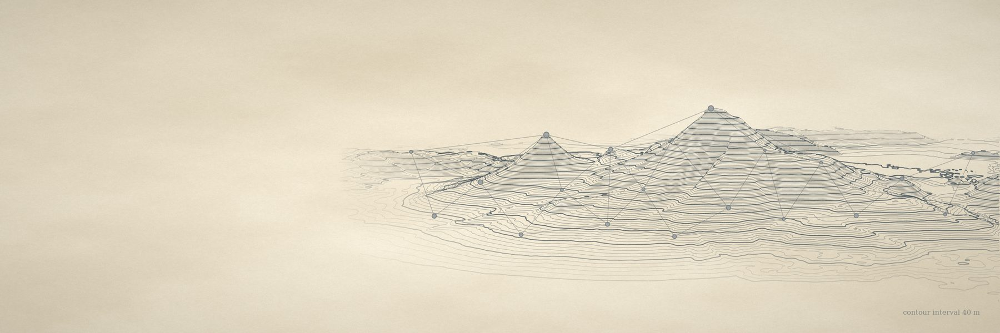<br><code>topo</code></td>
<td width="33%">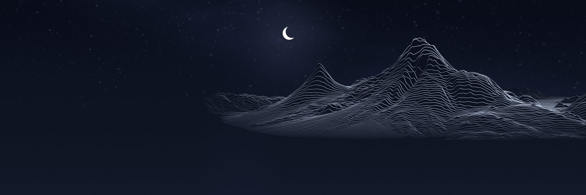<br><code>nocturne</code></td>
</tr>
<tr>
<td width="33%">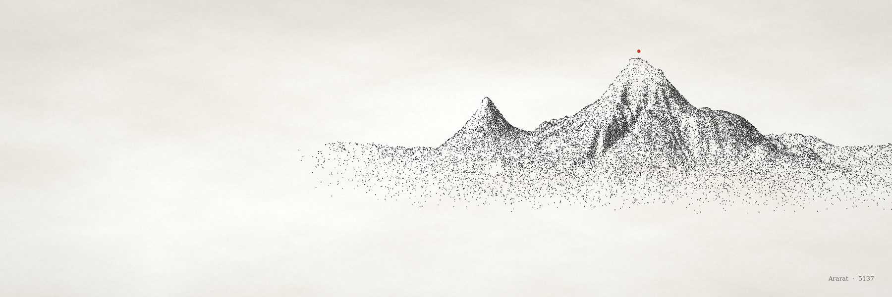<br><code>stipple</code></td>
<td width="33%">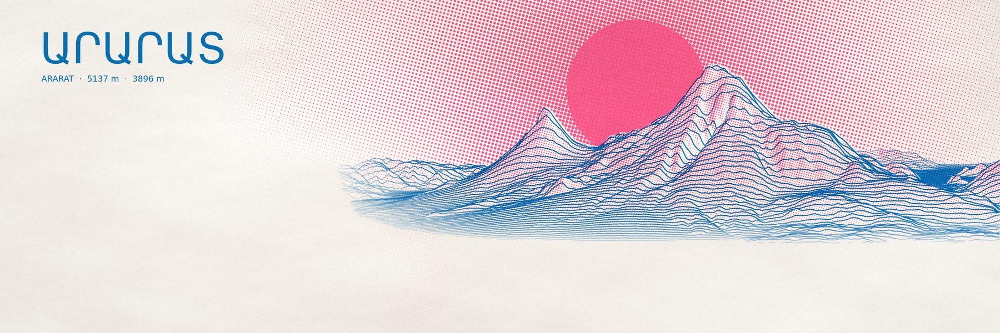<br><code>riso</code></td>
<td width="33%">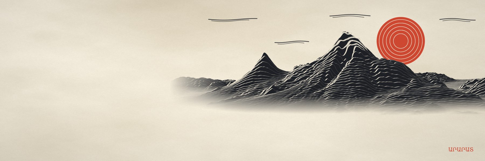<br><code>woodcut</code></td>
</tr>
</table>

## Any landform

The engine measures the ground around the summit before it frames anything: how steep the peak is for its footprint, what stands in front of it, how rough it is, whether it sits below a plateau. Cone volcanoes keep the original framing; horns, ranges, canyons and islands get their own.

<table>
<tr>
<td width="33%">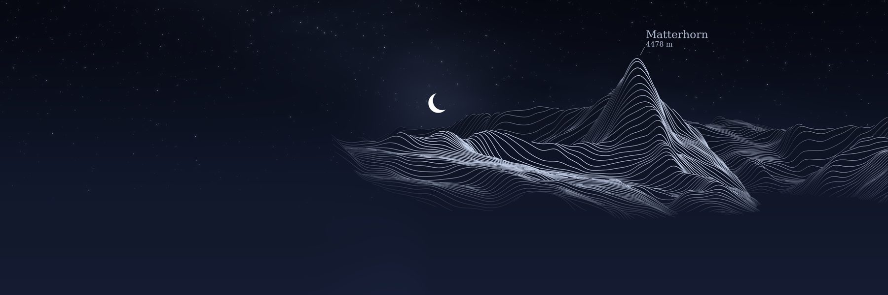<br>Matterhorn · horn</td>
<td width="33%">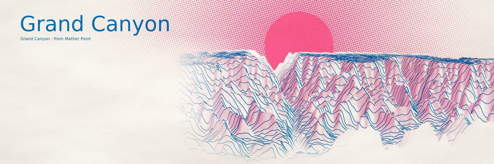<br>Grand Canyon · canyon</td>
<td width="33%">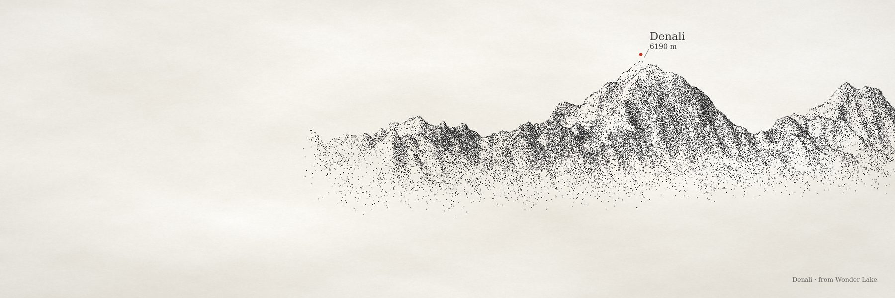<br>Denali · massif</td>
</tr>
<tr>
<td width="33%">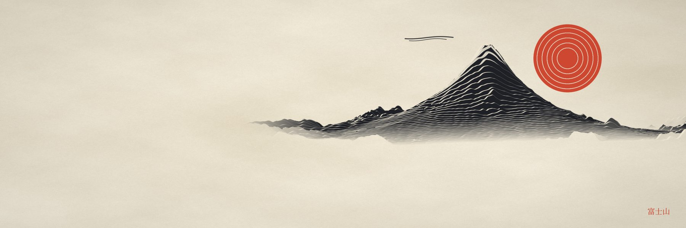<br>Fuji · cone</td>
<td width="33%">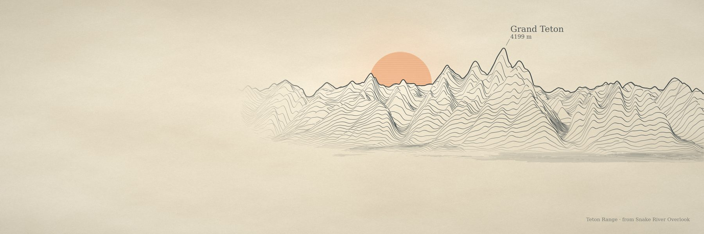<br>Tetons · range</td>
<td width="33%">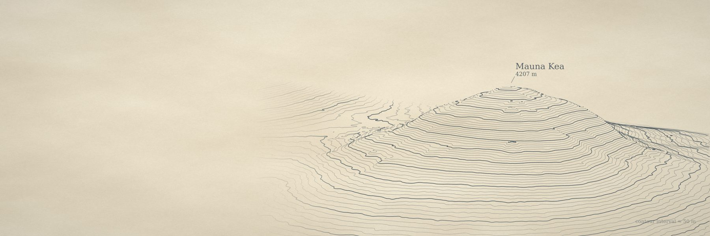<br>Mauna Kea · island volcano</td>
</tr>
</table>

<details>
<summary>Before and after: the Matterhorn</summary>

The first engine treated every mountain like Ararat, and the Matterhorn drowned in its own massif (top). Landform-aware framing raises the base from 1429 m to 2441 m and narrows the scene's half-width from 30.7 km to 10.8 km (bottom). Fuji, Ararat and Mauna Kea render identically before and after.

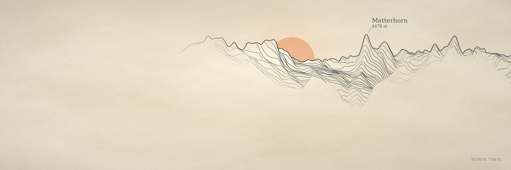
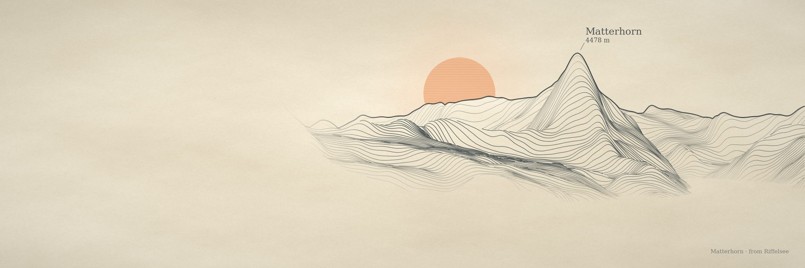
</details>

## Toward a photograph

The same elevation, ray-marched through a physical atmosphere: Rayleigh and Mie scattering, soft terrain shadows, valley mist, a lenticular cloud with multiple scattering. Lakes reflect the terrain with Fresnel and ripple normals. Trees, villages, stone walls and fields are placed near the camera, and a city at dusk is lit along its real OpenStreetMap streets.

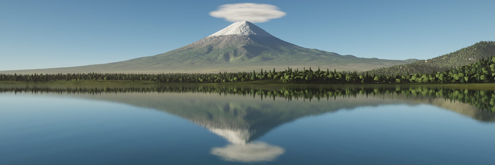

<table>
<tr>
<td width="50%">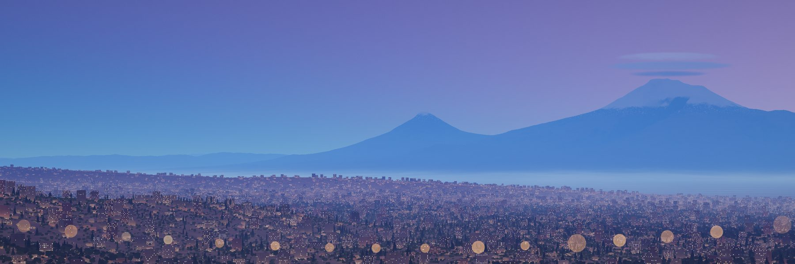<br>Blue hour over Yerevan, lamps on the real streets</td>
<td width="50%">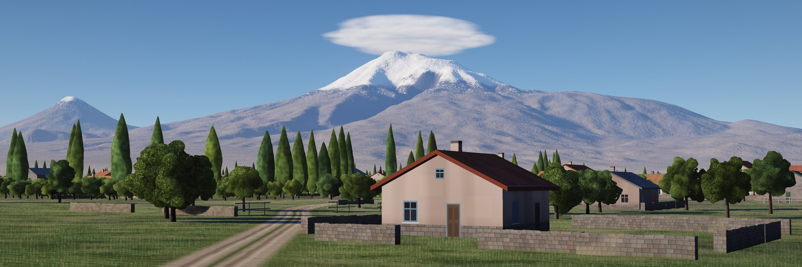<br>A village lane on the Ararat plain, camera 3 m up</td>
</tr>
</table>

There's also a [sunset timelapse](https://dogum.github.io/procedural-art/media/timelapse.mp4) along the real sun path for a date and place: every frame is rendered with the sun where it is at that moment, so shadows move across Yerevan as the sun sets behind Ararat and the street lights come on. A [4:5 version](https://dogum.github.io/procedural-art/media/timelapse_vertical.mp4) suits phones.

## Glass, from scratch

A Monte Carlo path tracer in plain numpy. Scenes are small JSON files: spheres, boxes, prisms, cut gems, hollow glasses with liquid in them. Multiple importance sampling and adaptive sampling make glass converge about 6.7× faster and copper 12× faster than a plain sampler.

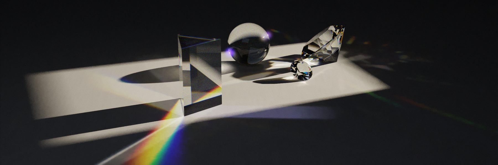

<table>
<tr>
<td width="50%">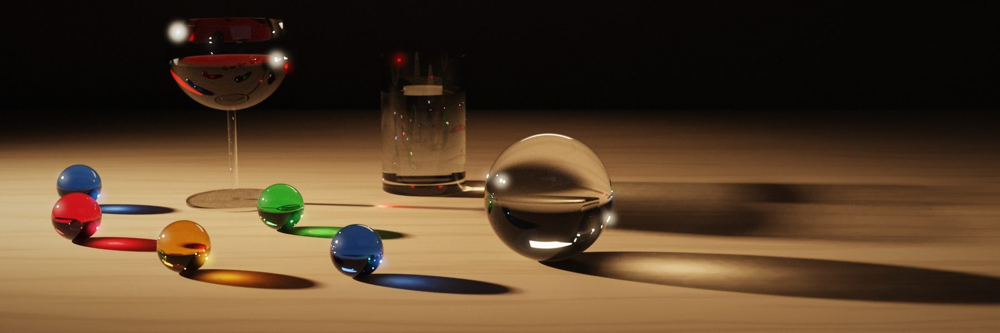<br>Wine and marbles</td>
<td width="50%">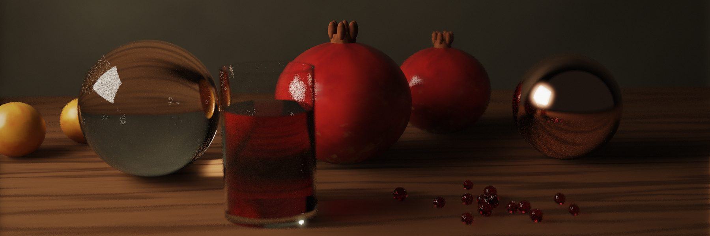<br>Pomegranates</td>
</tr>
</table>

## Then paint it

`paint.py` turns any image into oil, impasto, gouache, watercolour or ink, including a photo you give it. Brushes follow the contours of the picture; watercolour is built from transparent washes with wet edges and granulation.

<table>
<tr>
<td width="50%">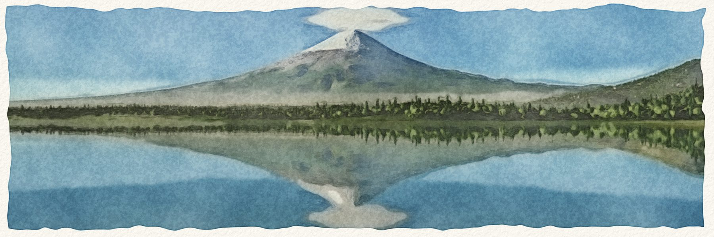<br><code>--style watercolor</code></td>
<td width="50%">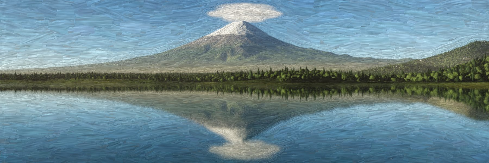<br><code>--style oil</code></td>
</tr>
</table>

## Install

### Claude Code (recommended)

```
/plugin marketplace add dogum/procedural-art
/plugin install procedural-art@procedural-art
```

All three skills install together. Updates arrive with `/plugin update`.

### Claude.ai, Cowork, cloud sessions

1. Download `procedural-terrain-art.skill`, `procedural-realism.skill` and `procedural-painting.skill` from the [latest release](https://github.com/dogum/procedural-art/releases/latest).
2. Open Claude.ai → Settings → Capabilities → Skills.
3. Upload each file. Re-upload to update.

### Manual, or any Agent Skills runtime

```bash
git clone https://github.com/dogum/procedural-art.git
mkdir -p ~/.claude/skills
cp -r procedural-art/skills/procedural-* ~/.claude/skills/
pip install -r procedural-art/requirements.txt
```

**Requirements:** Python 3 with numpy, scipy, pillow, matplotlib and contourpy (`requirements.txt`); ffmpeg for videos; network access to AWS Terrain Tiles for elevation (no key), and for a city at night to the OpenStreetMap Overpass API (cached after the first run). Everything runs on CPU.

## Try these

Once installed, just ask. The skills look up the summit and a real viewpoint, fetch the elevation, render a small draft, look at it, then render the final.

- *"Make me an X header of Mount Rainier from Seattle in the engraved-line style."*
- *"LinkedIn banner of the Grand Tetons as a black woodcut, big TETONS title."*
- *"Show me Denali in every style so I can pick one."*
- *"A 6-second looping orbit of the Matterhorn at night."*
- *"Build me an interactive page to play with Mount Hood from Portland."*
- *"Mont Blanc reflected in Lac Blanc at golden hour, photographic, no image model."*
- *"Sunset timelapse of Kilimanjaro from Amboseli, into the night."*
- *"A glass of whiskey with two ice cubes on walnut, window light. No Blender."*
- *"Turn this photo into a watercolour."*
- *"Paint a fishing harbour at dawn in oils, from code, and show me the film of it being painted."*
- *"An oil still life of pears and a copper pot. No image model."*
- *"Paint someone reading by a window, light across the floor, and build it in 3D first so the perspective is right."*
- *"A sunset timelapse of Rainier from Seattle as a moving oil painting."*

Or run the scripts yourself. From any writable folder, with `SK` pointing at the installed skill:

```bash
SK=~/.claude/skills/procedural-terrain-art
python $SK/scripts/render.py --peak 46.8523,-121.7603 --from 47.6062,-122.3321 \
  --style survey --size 3000x1000 --label "Mount Rainier|4392 m" --out rainier.png
```

That exact command, unedited, on a mountain none of the tests use (15 s):

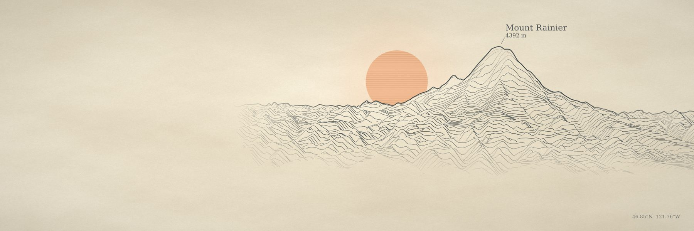

Each `SKILL.md` has the full workflow, and `references/` covers the engine, scene format, terrain features and painting presets.

## Studios in your browser

`build_studio.py` writes one HTML file (about 0.76 MB) with a 512 × 512 elevation grid inside. Orbit the mountain, move the light, change the ink, and save a 3000 × 1000 PNG. No server and no libraries; the only network request is for web fonts. Five are live on the site: [Ararat](https://dogum.github.io/procedural-art/studio/ararat.html), [Fuji](https://dogum.github.io/procedural-art/studio/fuji.html), [Matterhorn](https://dogum.github.io/procedural-art/studio/matterhorn.html), [Denali](https://dogum.github.io/procedural-art/studio/denali.html) and the [Grand Canyon](https://dogum.github.io/procedural-art/studio/grand-canyon.html). The same pages work as claude.ai artifacts, where the Save button uses the artifact download capability: see the [Ararat studio](https://claude.ai/artifact/2nyskwgoMR3ieJoZP3n1Dk) and the [showcase](https://claude.ai/artifact/XqYinY4hfHVU6PdxYz3548) on claude.ai.

The Ararat studio is also on [Artifact Shelf](https://dogum.github.io/artifact-shelf/a/masis/), a gallery of my single-file HTML artifacts.

## How it works

**Prints.** Elevation tiles become a grid aligned with the camera, rows running away from the viewer. Rows are projected near to far with a perspective camera, and a floating horizon per pixel column hides anything behind what's already drawn. A G-buffer records which row owns each pixel, so every style can sample height, shade and snow per pixel. Everything is normalised to a reference mountain, so a 1 km hill and an 8 km giant both fill the frame without retuning. [Engine notes](skills/procedural-terrain-art/references/engine.md).

**Photographs.** Each pixel's ray marches a 40 m heightfield (with Earth curvature) until it hits ground, then asks the sky how much light reaches that point and how much air lies between it and the camera. Near-field instances (water, trees, houses, lights) are traced separately. Renders run in resumable row bands. [Terrain features](skills/procedural-realism/references/terrain_features.md) · [What we learned](skills/procedural-realism/references/lessons.md).

**Paintings.** A study script computes the picture in flat colour with numpy (gradients, signed-distance shapes, light and shadow) and gives each mass a brush direction. The simulator seeds strokes inside each mass, traces them along that direction, and rasterises each as a ribbon of bristle tracks that mix with the wet paint beneath in pigment space; a height field of the paint is lit at the end. [Canvas API and internals](skills/procedural-painting/references/atelier.md).

**Glass.** Unidirectional path tracing with next-event estimation, MIS, Russian roulette, Fresnel and Beer-Lambert absorption, spectral dispersion, and an adaptive sampler that spends samples where noise is high. [Scene format](skills/procedural-realism/references/scenes.md).

## Performance

One CPU core:

| Output | Time |
|---|---|
| Print style, 3000 × 1000 | 5–15 s |
| All six styles + contact sheet | ~40 s |
| Studio page | ~5 s to build |
| Photographic terrain, 3000 × 1000 | 3–12 min (resumable) |
| Timelapse, 20 s at 1200 × 400, every frame rendered | ~2 hours on 4 cores, ~6 on one (resumable; `--blend 2` halves it) |
| Clean still life, 2400 × 800 | ~1 hour (resumable) |
| Painting, 3000 × 1000 | 10–60 s |
| Original oil painting, 2400 × 1600, 30k–80k strokes | 1–3 min (10–20 s per look at an 800 px draft) |
| The same painting live in a browser (the easel page) | 10–25 s |
| A moving painting, 241 frames at 1200 × 400 | ~20 min on 3 cores, after the timelapse frames (~30 min with `--blend 4`) |

## Limits

What works and what doesn't: light, atmosphere, glass, metal and real terrain at a distance look right. Trees, houses and walls within about 60 m look rendered rather than photographed; city buildings are boxes with guessed heights; paintings soften fine detail on noisy sources; organic shapes like petals are out of reach for the path tracer. Paintings from imagination are only as good as their drawing: figures from the 3D stage hold up to half length, with a plain face, mitten-like hands and a few folds; separate fingers, a gaze, real drapery and likenesses are still out of reach. Watercolours get the paper, the transparency and the edges right, but backruns are drawn more than simulated, they are soft at full size, and a mountain painted without the renderer's buffers is split into planes by tone alone. The skills say so when a request lands there.

## Repository layout

```
.claude-plugin/               plugin.json and marketplace.json (Claude Code)
skills/
  procedural-terrain-art/     SKILL.md, scripts/, references/, assets/studio_template.html, evals/
  procedural-realism/         SKILL.md, scripts/, references/, scenes/*.json, evals/
  procedural-painting/        SKILL.md, scripts/ (atelier.py: the paint simulator; stage.py; sitting.py; motion.py; repaint.py; tape.py), studies/*.py, references/
evals/                        claude plugin eval cases (should-trigger, should-not-trigger)
docs/                         GitHub Pages: the showcase, the Any mountain app (docs/app), the easel (docs/paint), five studios, media
scripts/                      build-skills.sh (the Claude.ai packages), build-app.py (docs/app/engine.js), regression_terrain.py
```

The two terrain skills ship the same `scripts/dem.py`; the build refuses to package them if the copies differ.

## Evals

```bash
claude plugin eval . --allow-tools Write Bash
```

Four should-trigger cases render real drafts and have an LLM judge look at the PNG; four should-not-trigger cases (Blender settings, a Midjourney prompt, a QGIS how-to, a plain fact) assert neither skill fires. Each skill also carries skill-creator evals. See [evals/README.md](evals/README.md).

## Contributing

Pictures welcome. See [CONTRIBUTING.md](CONTRIBUTING.md): change a skill, render a small before/after, run `scripts/build-skills.sh`, and if you touched the terrain engine, run the regression sheet. Made something with the skills you're proud of? Open an issue with the image and the prompt.

## Credits

Elevation data: [Terrain Tiles on AWS](https://registry.opendata.aws/terrain-tiles/) (SRTM, GMTED, ETOPO1 and other public sources; see the [attribution list](https://github.com/tilezen/joerd/blob/master/docs/attribution.md)). Street data for the city lights: © [OpenStreetMap contributors](https://www.openstreetmap.org/copyright), available under the Open Database License. Summit and viewpoint coordinates were looked up from public sources for each example. Built with Claude.

## License

[Apache 2.0](LICENSE).
